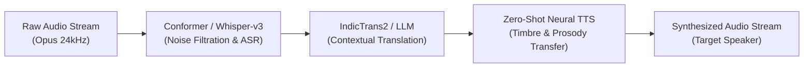

# 🎙️ AI Voice Translator

> **Real-Time Bidirectional Speech-to-Speech Translation Platform**  
> *Two people speak different languages, and the AI translates their speech in real time so each person can hear the conversation in their own native language and voice.*

---

## 🌟 Key Highlights & Concept

- **Speech in Language A ➔ AI Pipeline ➔ Voice in Language B**
- **Speech in Language B ➔ AI Pipeline ➔ Voice in Language A**
- **Example:**
  - **Hindi Speaker:** *"नमस्ते, क्या हाल है?"* ➔ **Tamil Speaker hears:** *"வணக்கம், எப்படி இருக்கிறீர்கள்?"*
  - **Tamil Speaker:** *"நான் நலமாக இருக்கிறேன்."* ➔ **Hindi Speaker hears:** *"मैं ठीक हूँ।"*

---

## ✨ Features

- **Bidirectional Two-Way Console**: Full duplex conversational interface between Speaker A and Speaker B.
- **Real-Time Speech Recognition (ASR)**: Uses modern Web Speech API (`SpeechRecognition`) for hands-free microphone voice capture.
- **Expressive Voice Synthesis (TTS)**: Synthesizes regional Indian dialects with pitch, intonation, and native accent tuning.
- **Acoustic Waveform Visualizer**: Live HTML5 Canvas visualizer rendering frequency harmonics during speech and playback.
- **Phonetic Pronunciation Guide**: Displays native script alongside Latin phonetic transliteration.
- **Interactive Scenarios**: Instant 1-click presets for real-world testing:
  - 🩺 *Healthcare Telemedicine (Hindi Doctor & Tamil Patient)*
  - 🚕 *Interstate Travel (Tamil Tourist & Delhi Auto Driver)*
  - 💻 *Tech Interview (English Director & Telugu Engineer)*
- **8+ Supported Languages**: Tamil (தமிழ்), Hindi (हिन्दी), Telugu (తెలుగు), Malayalam (മലയാളം), Kannada (ಕನ್ನಡ), English (Indian), Marathi (मराठी), and Bengali (বাংলা).
- **Clear Architectural Separation**: Distinguishes between the zero-setup in-browser demo and enterprise GPU edge cluster streaming pipelines.

---

## 🚀 Getting Started

The application is completely self-contained with no heavy compilation or build steps required.

### Quick Start (Double Click or Local Server)

1. Open `index.html` directly in any modern browser (Google Chrome or Microsoft Edge recommended for native Web Speech API microphone support).

2. Or run a lightweight local HTTP server:
   ```bash
   # Using Python
   python -m http.server 8000

   # Or using Node.js / npx
   npx serve .
   ```
   Then open `http://localhost:8000` in your browser.

---

## 📁 Project Structure

```
ai-voice-translator/
├── index.html            # Main semantic webpage with modern UI & responsive layout
├── css/
│   └── styles.css        # Obsidian dark theme, glassmorphism, glowing ripples, animations
├── js/
│   ├── languages-data.js # Multilingual dictionary, phonetic data, and realistic scenarios
│   ├── audio-engine.js   # Web Audio API visualizer, SpeechRecognition, and SpeechSynthesis
│   └── app.js            # UI state, bidirectional translation, history transcript, and event hooks
└── README.md             # Project documentation and architecture guide
```

---

## 🏗️ Production Architecture Specification

For high-scale cloud deployment, the platform connects via WebSockets/WebRTC to a GPU-accelerated cluster:



---

## 📄 License
MIT License. Built for seamless cross-lingual communication.
